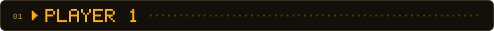
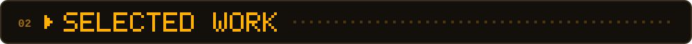
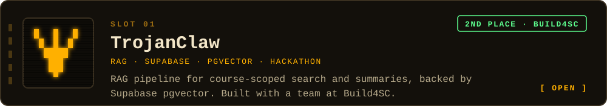
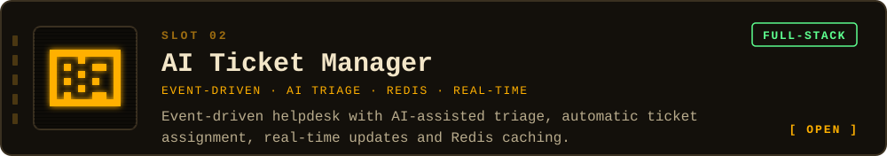
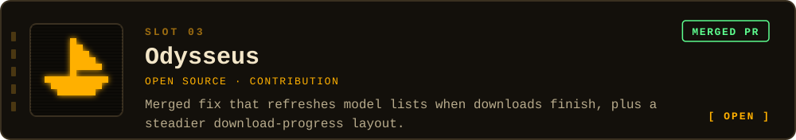
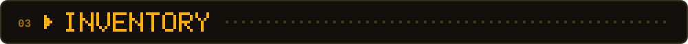
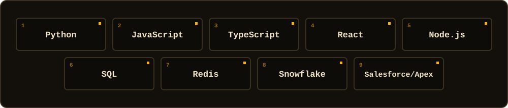
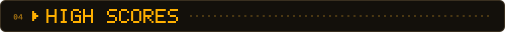
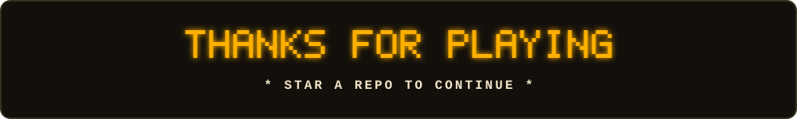

<div align="center">
  
</div>

<br />



```text
NAME ........... Aditya Lanjewar
CLASS .......... Software Developer
SPECIALTY ...... Backend systems · Data pipelines · Practical AI
XP ............. Production work on Snowflake + Salesforce
SIDE QUEST ..... Full-stack tools that make complex workflows simpler
ACHIEVEMENT .... 2nd place — Build4SC Hackathon
```

<br />



<a href="https://github.com/aditya1165/TrojanClaw">
  
</a>
<a href="https://github.com/aditya1165/AI-ticket-manager">
  
</a>
<a href="https://github.com/aditya1165/odysseus">
  
</a>

<br /><br />





<br /><br />



<div align="center">
  <br />
  
  
  
  <br /><br />
  
  <br /><br />
</div>


