

<picture><source media="(prefers-color-scheme: dark)" srcset="./assets/header-dark.svg"><source media="(prefers-color-scheme: light)" srcset="./assets/header-light.svg"></picture>
<picture><source media="(prefers-color-scheme: dark)" srcset="./assets/sec-about-dark.svg"><source media="(prefers-color-scheme: light)" srcset="./assets/sec-about-light.svg">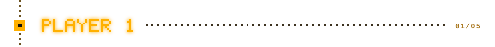</picture>
<picture><source media="(prefers-color-scheme: dark)" srcset="./assets/about-dark.svg"><source media="(prefers-color-scheme: light)" srcset="./assets/about-light.svg"></picture>
<picture><source media="(prefers-color-scheme: dark)" srcset="./assets/sec-work-dark.svg"><source media="(prefers-color-scheme: light)" srcset="./assets/sec-work-light.svg"></picture>
<a href="https://github.com/aditya1165/TrojanClaw-Integrated"><picture><source media="(prefers-color-scheme: dark)" srcset="./assets/card-trojanclaw-dark.svg"><source media="(prefers-color-scheme: light)" srcset="./assets/card-trojanclaw-light.svg">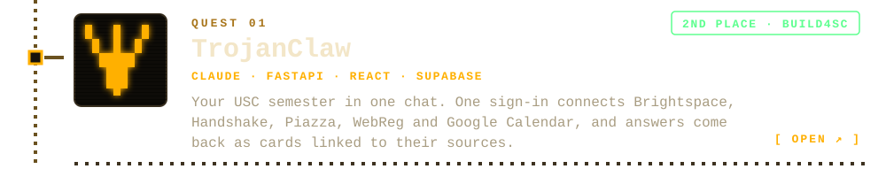</picture></a>
<a href="https://github.com/aditya1165/NorthStar"><picture><source media="(prefers-color-scheme: dark)" srcset="./assets/card-northstar-dark.svg"><source media="(prefers-color-scheme: light)" srcset="./assets/card-northstar-light.svg">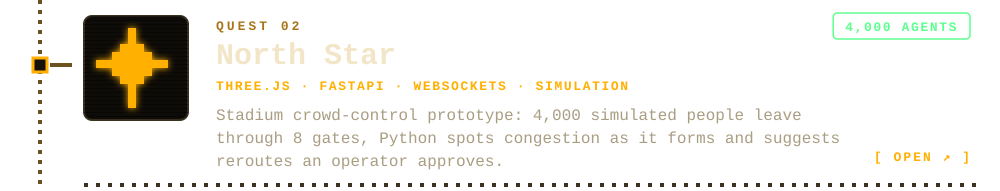</picture></a>
<a href="https://github.com/aditya1165/InSync"><picture><source media="(prefers-color-scheme: dark)" srcset="./assets/card-insync-dark.svg"><source media="(prefers-color-scheme: light)" srcset="./assets/card-insync-light.svg">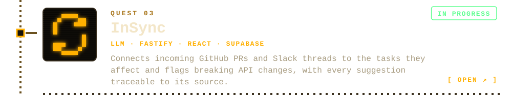</picture></a>
<a href="https://github.com/aditya1165/AI-ticket-manager"><picture><source media="(prefers-color-scheme: dark)" srcset="./assets/card-ticket-dark.svg"><source media="(prefers-color-scheme: light)" srcset="./assets/card-ticket-light.svg">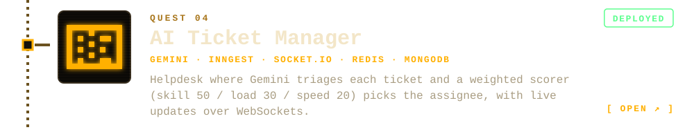</picture></a>
<picture><source media="(prefers-color-scheme: dark)" srcset="./assets/sec-side-dark.svg"><source media="(prefers-color-scheme: light)" srcset="./assets/sec-side-light.svg"></picture>
<a href="https://github.com/odysseus-dev/odysseus/pulls?q=is%3Apr+author%3Aaditya1165"><picture><source media="(prefers-color-scheme: dark)" srcset="./assets/side-odysseus-dark.svg"><source media="(prefers-color-scheme: light)" srcset="./assets/side-odysseus-light.svg">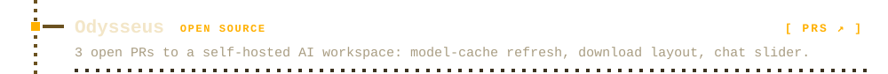</picture></a>
<a href="https://github.com/aditya1165/tara-cafe"><picture><source media="(prefers-color-scheme: dark)" srcset="./assets/side-tara-dark.svg"><source media="(prefers-color-scheme: light)" srcset="./assets/side-tara-light.svg">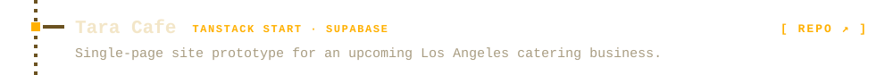</picture></a>
<picture><source media="(prefers-color-scheme: dark)" srcset="./assets/sec-tools-dark.svg"><source media="(prefers-color-scheme: light)" srcset="./assets/sec-tools-light.svg">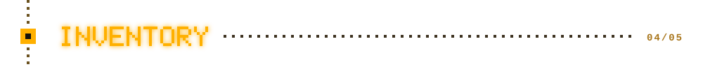</picture>
<picture><source media="(prefers-color-scheme: dark)" srcset="./assets/inventory-dark.svg"><source media="(prefers-color-scheme: light)" srcset="./assets/inventory-light.svg">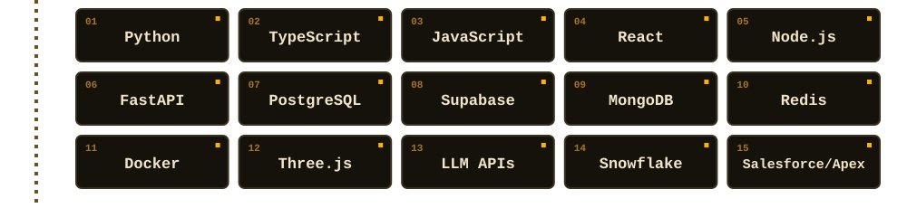</picture>
<picture><source media="(prefers-color-scheme: dark)" srcset="./assets/sec-stats-dark.svg"><source media="(prefers-color-scheme: light)" srcset="./assets/sec-stats-light.svg">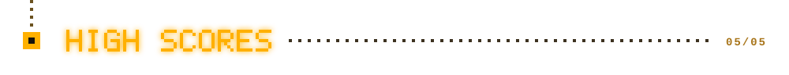</picture>
  
<picture><source media="(prefers-color-scheme: dark)" srcset="https://ghstats.dev/api/mini?username=aditya1165&metric=contributions&label=Contributions&style=for-the-badge&theme=gruvbox&color=b57614"><source media="(prefers-color-scheme: light)" srcset="https://ghstats.dev/api/mini?username=aditya1165&metric=contributions&label=Contributions&style=for-the-badge&theme=light&color=b35f00"></picture>
<picture><source media="(prefers-color-scheme: dark)" srcset="https://ghstats.dev/api/mini?username=aditya1165&metric=prs&label=Pull%20Requests&style=for-the-badge&theme=gruvbox&color=b57614"><source media="(prefers-color-scheme: light)" srcset="https://ghstats.dev/api/mini?username=aditya1165&metric=prs&label=Pull%20Requests&style=for-the-badge&theme=light&color=b35f00"></picture>
<picture><source media="(prefers-color-scheme: dark)" srcset="https://ghstats.dev/api/mini?username=aditya1165&metric=repos&label=Public%20Repos&style=for-the-badge&theme=gruvbox&color=b57614"><source media="(prefers-color-scheme: light)" srcset="https://ghstats.dev/api/mini?username=aditya1165&metric=repos&label=Public%20Repos&style=for-the-badge&theme=light&color=b35f00"></picture>
  
<picture><source media="(prefers-color-scheme: dark)" srcset="https://ghstats.dev/api/langs?username=aditya1165&theme=gruvbox&layout=compact"><source media="(prefers-color-scheme: light)" srcset="https://ghstats.dev/api/langs?username=aditya1165&theme=light&layout=compact&title_color=b35f00&border_color=e0d6c2"></picture>
  
<picture><source media="(prefers-color-scheme: dark)" srcset="./assets/footer-dark.svg"><source media="(prefers-color-scheme: light)" srcset="./assets/footer-light.svg">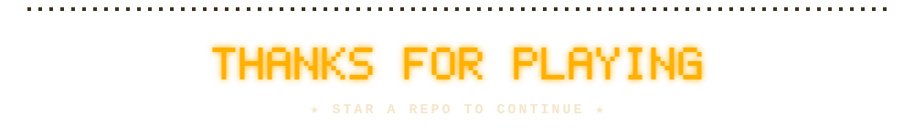</picture>

